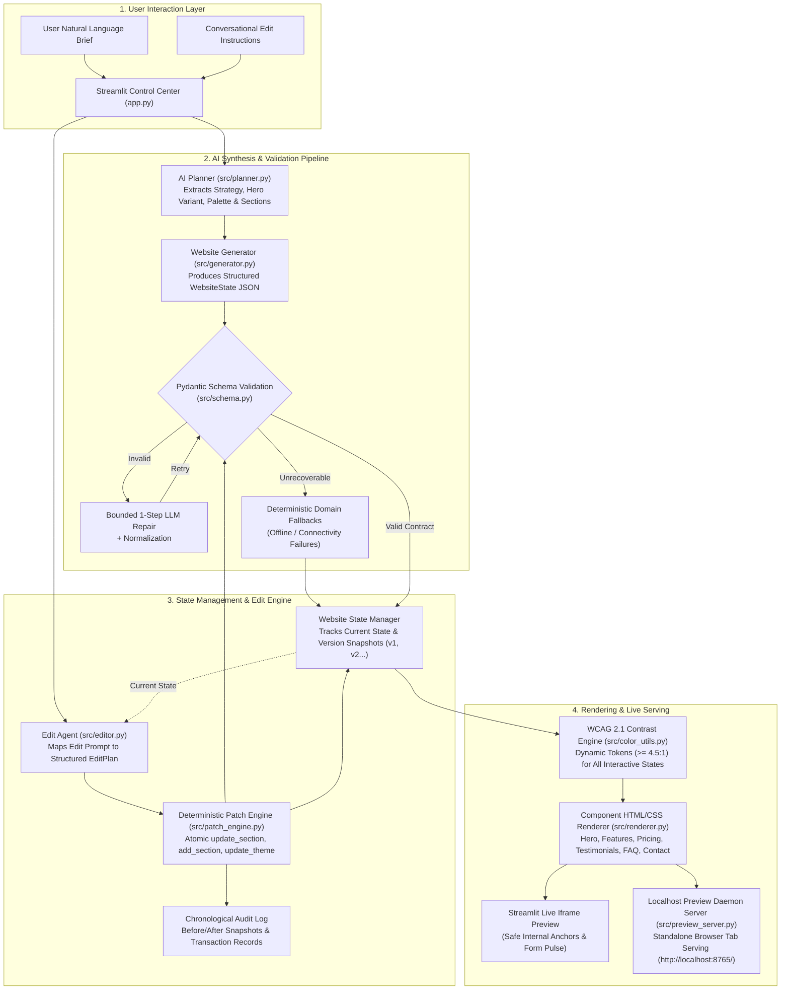

# SitePilot AI — Agentic No-Code Website Builder

[](https://www.python.org/downloads/)
[](https://streamlit.io/)
[](https://docs.pydantic.dev/)
[](https://pytest.org/)
[](https://www.w3.org/WAI/WCAG21/quickref/)
[](LICENSE)

SitePilot AI is a production-grade, explainable AI-powered no-code website builder. A user submits a business brief in natural language (e.g., *"Create an energetic website for a boutique fitness studio with training packages, testimonials, and appointment booking"*), and the system autonomously synthesizes a complete, responsive, and visually distinct website using a predefined component library.

Users can preview the generated website in real time, launch it in a standalone browser tab, and execute follow-up conversational edits (e.g., *"Make the buttons emerald green #10B981"*, *"Center align contact details"*, *"Add an FAQ section before contact"*) via **deterministic, transactional JSON patches** with full version history and instant rollback.

---

## 🏛️ System Architecture



---

## 🚀 Supported Model Providers

SitePilot AI features a unified OpenAI-compatible client adapter that switches seamlessly between cloud and local providers with automatic credential validation, key masking, and health checks:

| Provider | Role | Default Model | Base URL | Primary Use Case |
| :--- | :--- | :--- | :--- | :--- |
| **NVIDIA NIM** *(Default)* | Primary Prototype | `nvidia/nemotron-3.5-bolt-e4b` | `https://integrate.api.nvidia.com/v1` | High-throughput, cloud-hosted prototype generation |
| **Ollama** | Local Backup | `qwen2.5:3b` | `http://localhost:11434/v1` | 100% offline, privacy-first local LLM inference |
| **OpenAI** | Baseline Option | `gpt-4o-mini` | `https://api.openai.com/v1` | Industry-standard cloud baseline |

---

## 🛠️ Setup & Run Instructions

### 1. Prerequisites
- **Python 3.10+** (tested up to Python 3.12)
- **Git**

### 2. Clone Repository & Setup Virtual Environment
```powershell
# Clone the repository
git clone https://github.com/AnoushkaI/Agentic-NoCode-Website-Builder.git
cd Agentic-NoCode-Website-Builder

# Create virtual environment
python -m venv venv

# Activate virtual environment
# Windows (PowerShell):
.\venv\Scripts\Activate.ps1
# Windows (CMD):
.\venv\Scripts\activate.bat
# macOS / Linux:
source venv/bin/activate

# Install dependencies
pip install -r requirements.txt
```

### 3. Provider Configuration (`.env`)
Copy `.env.example` to create your local `.env`:
```powershell
copy .env.example .env
```

Configure your credentials according to your chosen provider:

#### Option A: NVIDIA NIM (Default Cloud Prototype)
```ini
LLM_PROVIDER=nvidia
NVIDIA_API_KEY=nvapi-your-key-here
NVIDIA_BASE_URL=https://integrate.api.nvidia.com/v1
NVIDIA_MODEL=nvidia/nemotron-3.5-bolt-e4b
```
*(Get a free API key at [NVIDIA Build](https://build.nvidia.com/))*

#### Option B: Ollama (Local Offline Inference)
```ini
LLM_PROVIDER=ollama
OLLAMA_BASE_URL=http://localhost:11434/v1
OLLAMA_MODEL=qwen2.5:3b
```
Ensure Ollama is running locally:
```powershell
ollama pull qwen2.5:3b
ollama serve
```

#### Option C: OpenAI
```ini
LLM_PROVIDER=openai
OPENAI_API_KEY=sk-your-openai-key-here
OPENAI_BASE_URL=https://api.openai.com/v1
OPENAI_MODEL=gpt-4o-mini
```

### 4. Launch the Streamlit Application
```powershell
streamlit run app.py
```
Open your browser at `http://localhost:8501`.

### 5. Run the Automated Test Suite
Run all 105 automated unit, schema, regression, and accessibility tests:
```powershell
python -m pytest tests/ -v
```

### 6. Run the 10-Sample Benchmark Evaluation
Run the automated evaluation benchmark across 10 diverse industry test cases:
```powershell
python scripts/evaluate.py
```
Outputs are written directly to:
- `data/evaluation_results.json` (comprehensive telemetry and metrics)
- `data/evaluation_results.csv` (tabular benchmarks)

---

## 💡 Key Design Decisions & Engineering Tradeoffs

### 1. Pydantic Contract vs. Raw HTML Generation
- **Decision:** AI models generate strictly validated `WebsiteState` JSON matching a Pydantic schema, which a deterministic Python engine translates into HTML/CSS.
- **Why:** Eliminates prompt injection vulnerabilities, prevents arbitrary `<script>` execution, ensures responsive grid consistency, and guarantees that downstream conversational edits modify specific properties rather than causing cascading template breakdowns.

### 2. Hybrid Layout Variant Component Library vs. Monolithic Templates
- **Decision:** Reusable parameterized section components (Hero, Features, Pricing, Testimonials, FAQ, Contact) with layout variants (`split`, `centered`, `minimal`, `storefront`, `editorial`, `pill_cards`, `cards`).
- **Why:** Pure fixed templates make every website look identical, while unconstrained drag-and-drop systems introduce excessive complexity. The hybrid strategy lets the AI Planner choose section order, layout variants, color schemes, and typography tailored to each business brief.

### 3. Deterministic Transactional Patch Engine vs. Full Regeneration
- **Decision:** Conversational edits propose atomic JSON patch operations (`update_section`, `add_section`, `remove_section`, `reorder_sections`, `update_theme`).
- **Why:** Full regeneration is slow, expensive, and frequently modifies parts of the website the user wanted to keep. The deterministic patch engine mutates only targeted fields in an isolated copy, validates with Pydantic, applies strict no-op detection, and commits with version snapshots ($v_1 \to v_2$).

### 4. Bounded 1-Step Schema Repair with Pre-Validation Normalization
- **Decision:** Normalize incoming content structures (e.g. converting plain strings into required dictionaries) before schema validation, with a strict maximum of one repair LLM call on failure.
- **Why:** Unbounded repair loops consume excessive tokens and lead to unpredictable latency. Pre-validation normalization catches common LLM idiosyncrasies deterministically, while bounded repair provides robust self-healing without infinite loops.

### 5. Mathematical WCAG 2.1 AA Dynamic Color Contrast
- **Decision:** Calculate relative luminance ($L = 0.2126R + 0.7152G + 0.0722B$) and contrast ratios ($(L_1 + 0.05) / (L_2 + 0.05)$) dynamically for all theme colors, buttons, card surfaces, navigation links, and hover/active states.
- **Why:** AI models frequently pair brand colors that produce illegible text (e.g., white text on bright yellow buttons). Dynamically calculating high-contrast foregrounds ($\ge 4.5:1$) guarantees accessibility across light, dark, and vibrant themes.

### 6. Dual Preview: In-App Iframe + Standalone Localhost Daemon Server
- **Decision:** Provide an embedded Streamlit iframe with internal smooth-scrolling anchors (`#appointment-form`) plus a lightweight local HTTP daemon server (`src/preview_server.py` on `http://localhost:8765/`).
- **Why:** Streamlit iframes sometimes restrict popups or multi-tab navigation. Serving in-memory HTML locally with cache-busting headers (`Cache-Control: no-cache, no-store, must-revalidate`) allows users to click **"🌐 Open in Browser"** and test real responsiveness on multiple monitors without external hosting.

---

## 📊 10 Sample Inputs & Benchmark Evaluation Suite

The repository includes 10 richly detailed, real-world business briefs in [data/sample_inputs.json](data/sample_inputs.json) spanning distinct industries, tones, and layout strategies:

| Sample ID | Business Name | Industry | Target Layout | Sample Conversational Edit |
| :--- | :--- | :--- | :--- | :--- |
| `sample-01` | **Zenith Fitness Studio** | Fitness & Wellness | `bold_promotional` (`split`) | *"Change hero button text to Claim 7-Day Pass"* |
| `sample-02` | **Artisan Crust Bakery & Cafe** | Food & Retail | `editorial_story` (`editorial`) | *"Change brand color to warm terracotta #C2410C"* |
| `sample-03` | **PulseFlow Analytics** | B2B SaaS / Telemetry | `saas_showcase` (`split`) | *"Update hero CTA button to Start Free Cloud Trial"* |
| `sample-04` | **Paws & Claws Luxury Pet Resort** | Pet Care & Boarding | `modern_showcase` (`split`) | *"Change primary button color to #0D9488"* |
| `sample-05` | **Aura Interior Architecture** | Design & Architecture | `editorial_story` (`editorial`) | *"Set theme background to ivory #FFFDF9"* |
| `sample-06` | **Helios Clean Energy Solutions** | Renewable Cleantech | `modern_showcase` (`centered`) | *"Change primary theme color to emerald #10B981"* |
| `sample-07` | **Veritas Legal & Advisory** | Corporate & IP Law | `editorial_story` (`split`) | *"Change primary button color to navy blue #1E3A8A"* |
| `sample-08` | **Origin Roast Single-Estate** | E-Commerce / Specialty | `storefront_catalog` (`storefront`) | *"Update hero CTA button to Subscribe to Fresh Beans"* |
| `sample-09` | **Serenity Mind Counseling** | Mental Health & Therapy | `editorial_story` (`minimal`) | *"Change theme primary color to soothing teal #0D9488"* |
| `sample-10` | **Apex CyberDefense Systems** | Cybersecurity / SOC | `saas_showcase` (`split`) | *"Change primary button color to indigo #4F46E5"* |

### Benchmark Evaluation Results Summary

Running `python scripts/evaluate.py` benchmarks the complete generation, accessibility, editing, and rollback pipeline:

```text
==========================================================================================
SitePilot AI — Evaluation Benchmark Results Summary
==========================================================================================
Timestamp:        2026-11-19T11:30:04Z
Provider Tested:  offline_deterministic_engine
Total Test Cases: 10
Overall Status:   ALL_PASSED
------------------------------------------------------------------------------------------
Metric                                          Score
------------------------------------------------------------------------------------------
Plan Schema Validity Rate                      100.0%
State Schema Validity Rate                     100.0%
Section Completeness Rate                      100.0%
WCAG 2.1 AA Contrast Rate (>=4.5:1)            100.0%
Heading & Title Emoji-Free Rate                100.0%
HTML/CSS Render Success Rate                   100.0%
Conversational Edit Success Rate               100.0%
No-Op Detection & Rejection Rate               100.0%
Version Rollback Success Rate                  100.0%
Average End-to-End Latency                    5.98 ms
==========================================================================================
```

- **JSON Results:** [data/evaluation_results.json](data/evaluation_results.json)
- **CSV Results:** [data/evaluation_results.csv](data/evaluation_results.csv)

---

## 📂 Project Structure

```text
Agentic-NoCode-Website-Builder/
├── app.py                          # Streamlit application UI & control center
├── requirements.txt                # Production and development dependencies
├── .env.example                    # Environment credentials configuration template
├── .gitignore                      # Git exclusion rules
├── README.md                       # Architectural documentation & developer guide
├── PROJECT_PROGRESS.md             # Detailed engineering phase tracking & audit log
├── data/
│   ├── sample_inputs.json          # 10 comprehensive benchmark test cases
│   ├── evaluation_results.json     # Detailed evaluation metrics & telemetry
│   └── evaluation_results.csv      # Tabular benchmark scorecard
├── scripts/
│   └── evaluate.py                 # Automated evaluation benchmark harness
├── src/
│   ├── __init__.py
│   ├── config.py                   # Provider settings & credential management
│   ├── schema.py                   # Pydantic data contracts (WebsiteState, Section, EditPlan)
│   ├── planner.py                  # High-level architecture and design strategy planner
│   ├── generator.py                # Website JSON generator with bounded self-repair
│   ├── renderer.py                 # Parameterized HTML/CSS layout and section renderer
│   ├── editor.py                   # Conversational Edit Agent & natural-language parser
│   ├── patch_engine.py             # Deterministic transactional patch engine & rollback
│   ├── color_utils.py              # WCAG 2.1 AA contrast math & dynamic interactive tokens
│   ├── preview_server.py           # Local background HTTP server for external browser tabs
│   ├── image_service.py            # Thematic imagery resolution & visual fallback cards
│   └── providers/
│       ├── __init__.py
│       ├── base.py                 # Abstract BaseProvider and standardized response models
│       ├── openai_compatible.py    # Unified adapter for NVIDIA NIM, Ollama, OpenAI
│       └── factory.py              # Provider factory & health test orchestrator
└── tests/
    ├── __init__.py
    ├── test_provider.py            # LLM provider connectivity & credential masking tests
    ├── test_generation.py          # Schema validation, repair, and planner tests
    ├── test_renderer.py            # HTML rendering, layout variants, and anchor tests
    └── test_editor.py              # Patch operations, WCAG contrast, no-op, & rollback tests
```

---

## 📄 License
This project is licensed under the MIT License. See [LICENSE](LICENSE) for details.
